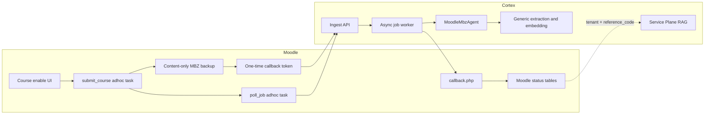
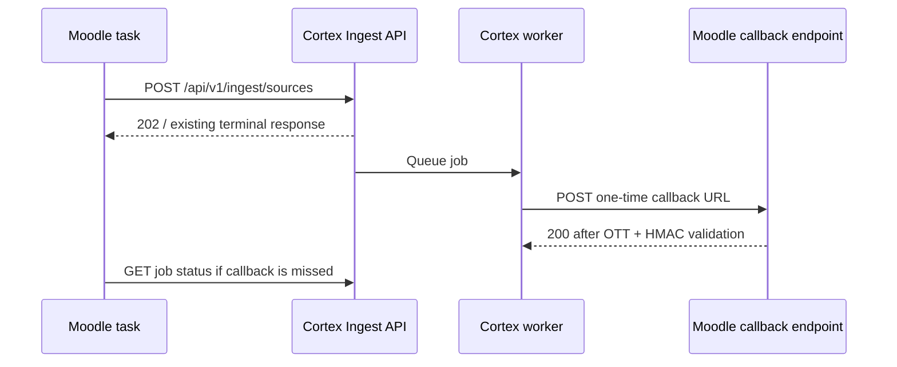

# Architecture

## Purpose and boundaries

The integration joins Moodle's course-backup subsystem to Cortex's existing
asynchronous ingestion pipeline. It deliberately does not add Moodle-specific
logic to Cortex's retrieval or embedding layers:

- **Moodle** owns course enablement, backup creation, submit orchestration,
  callback validation, and visible job status.
- **Cortex Ingest Plane** accepts the backup, assigns corpus/job identifiers,
  persists the source, and queues processing.
- **Cortex `moodle_mbz` Content Type Agent** turns the backup into CIR.
- **Cortex Engine Plane** performs shared extraction, embedding, and storage.
- **Cortex Service Plane** is the later RAG consumer, scoped by Moodle's saved
  `tenant_id` and `reference_code`.



## Course lifecycle

The browser request is intentionally small. It never creates a backup, makes
an HTTP submit, or waits for Cortex.

1. A user with `local/cortex:manage` opens **Cortex knowledge** in the course
   navigation and turns on *Use Cortex knowledge for this course*.
2. Moodle inserts or updates `local_cortex_course`, marks it `queued`, and
   queues `\local_cortex\task\submit_course`.
3. The adhoc task obtains a site-wide submit slot, creates a content-only
   backup, and rejects it before upload if it exceeds the configured raw size.
4. The task mints a one-time callback URL, submits the `.mbz` to Cortex, and
   records `reference_code`, `job_id`, `corpus_id`, and `content_hash`.
5. For a new asynchronous job, Cortex later calls Moodle's callback URL. A
   required delayed polling task independently checks job status if the
   callback is missed.
6. Moodle records terminal `ready` or `failed` state and the completion source
   (`callback`, `poll`, or `idempotent`).

Disabling the course prevents future work from being queued and marks the
Moodle row `disabled`. It does not delete a previously issued Cortex corpus or
`reference_code`.

## Plugin layout and responsibilities

```text
local/cortex/
  course_settings.php              Course enable and manual Resync page
  course_status.php                Read-only status page
  callback.php                     No-login signed Cortex webhook
  settings.php                     Site-wide configuration screen
  db/
    install.xml                    Course and callback-token tables
    access.php                     Role capabilities
    services.php                   OTT mint external web service
  classes/
    task/submit_course.php         Backup, submit, idempotency, concurrency
    task/poll_job.php              Callback-miss safety net
    local/backup_exporter.php      Moodle backup_controller integration
    local/ingest_client.php        Cortex HTTP client
    local/callback_token.php       OTT mint/bind/consume helpers
    local/course_state.php         Course state persistence and terminal updates
    local/concurrency.php          Named-lock counting semaphore
    local/hmac.php                 Raw-body callback signature verifier
    external/generate_callback_url.php
```

## Concurrency and idempotency

`local_cortex` limits simultaneous backup-and-submit executions with named
Moodle locks. The setting defaults to two slots. If all slots are occupied,
`submit_course` keeps the row queued and schedules itself again after 60
seconds.

The limit applies only to Moodle's expensive backup/submit segment. A slot is
released after Cortex responds; it is not held while Cortex performs its
pipeline work.

Cortex is content-idempotent for the combination of tenant, external corpus
ID, content hash, and embedding standard. The Moodle plugin saves the SHA-256
hash of submitted backup bytes. If Cortex returns an existing terminal job
(`ready` or `failed`), it will not send a new callback. Moodle applies that
terminal state immediately, expires the newly minted callback token, and does
not wait or poll.

## Completion paths

There are two completion paths and either can safely finish a course:

| Path | Normal use | Behaviour |
| --- | --- | --- |
| Callback | Primary / low-latency | Cortex posts a signed terminal payload to a one-time Moodle URL. |
| Poll | Required safety net | Moodle checks `GET /api/v1/ingest/jobs/{job_id}` after 15m, 30m, 1h, and 2h; the fifth permitted attempt repeats the final 2h delay. It stops at terminal state or after five attempts. |

Both paths call the same `course_state::apply_terminal_state()` method. It is
idempotent for a matching job ID, so a callback and a poll race cannot create
two state transitions.

## Network topology

The integration requires two independent, reverse network paths:



- **Moodle → Cortex:** `CORTEX_INGEST_URL` must be reachable from Moodle's web
  and cron containers.
- **Cortex → Moodle:** `CORTEX_CALLBACK_BASE` must be an absolute URL reachable
  by Cortex workers. It must route to
  `/local/cortex/callback.php`.

The two URLs may use different hostnames and networks. Successful Moodle-to-
Cortex connectivity does not prove Cortex can reach Moodle.
